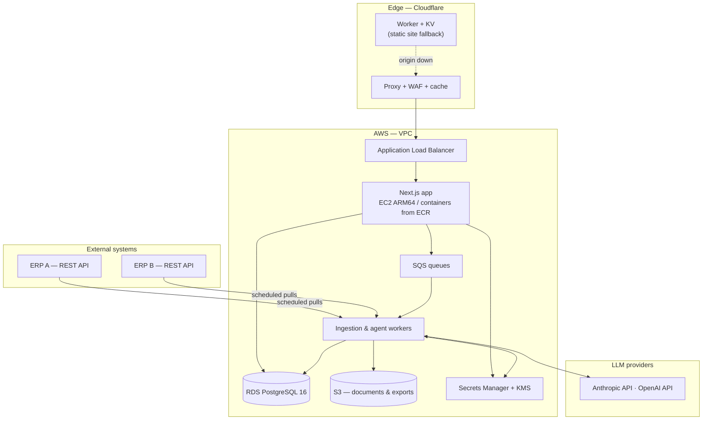

# Engineering case study: a production ERP-integration platform

This repository contains **no source code**. It documents the architecture,
infrastructure and operational decisions behind a B2B SaaS platform I build and
operate for industrial construction companies, and what running it in production
has taught me.

Company and customer names are omitted deliberately. Everything described here is
my own engineering work, written up at a level of detail that does not expose
proprietary code, data or credentials.

---

## 1. The problem

Construction companies in the industrial market run their operation on an ERP, but
the ERP answers accounting questions, not management questions. "Which contracts
are burning budget faster than they are advancing?" is a question that requires
joining data the ERP keeps in separate places, and the answer gets assembled by
hand, in spreadsheets, once a month.

The platform's job is to pull that data continuously, model it once, and make it
answerable in seconds.

It started as a Power BI report wired directly to a single ERP's REST API. That
version worked and proved the demand, but it had three ceilings: one ERP, one
customer, and no way to act on what the data showed. Everything below is the
consequence of removing those ceilings.

## 2. Architecture

**Shape of it.** A Next.js application serves the product. Ingestion and
agent work is pulled off the request path onto SQS-backed workers, because an ERP
sync that takes four minutes cannot sit inside an HTTP request and an LLM call that
takes twelve seconds should not either. PostgreSQL is the single source of truth;
every ERP's payload is normalised into one internal model on the way in, so adding
an ERP means writing an adapter, not re-teaching the whole system a new vocabulary.

## 3. Infrastructure decisions

Infrastructure is defined in Terraform. The decisions worth defending:

| Decision | Reasoning |
|---|---|
| **EC2 on ARM64 (Graviton)** rather than x86 | Same workload, meaningfully lower hourly cost. The application is containerised, so the architecture switch cost one build-pipeline change. |
| **RDS PostgreSQL 16**, managed, not self-hosted | Backups, point-in-time recovery and minor-version patching are not where I want to spend attention. The money buys sleep. |
| **SQS between app and workers** | Decouples the slow, failure-prone work (third-party APIs, LLM calls) from the user-facing request. A provider outage becomes a queue backlog instead of a 502. |
| **Secrets Manager + KMS**, never in the repository | Credentials rotate without a deploy, and nothing sensitive sits in Git history. This one is non-negotiable and I treat it that way. |
| **Cloudflare in front of the ALB**, with a Worker + KV copy of the institutional site | The marketing site has different availability requirements from the product. Serving it from the edge means the public page stays up even when the origin does not — the first thing a prospective customer sees should never be a 502. |
| **CloudWatch + SNS for alerting** | Already inside the account, already has the metrics, and alarms reach a phone. Adding an external observability vendor would have been nicer and slower. |

## 4. Environments and delivery

The platform runs across a large set of environments — production, staging, and a
disposable environment created per pull request so a reviewer can click through a
change instead of reading a diff and hoping.

Two things made that sustainable:

- **Ephemeral QA environments are shut down automatically when their deploy
  finishes.** Per-PR environments are wonderful and, left running, quietly become
  the largest line on the bill. Tearing them down on deploy completion cut several
  dollars per release day — small in absolute terms, and the difference between a
  practice that survives and one that gets switched off during a cost review.
- **Migrations are part of the deploy, and the deploy verifies them.** This came
  from being burned: the QA environment template once recorded a migration as
  already applied without having created the tables, so every branch built on it
  failed in a way that looked like the branch's fault. The fix was to stop trusting
  the recorded state and assert the schema actually exists.

## 5. The LLM layer

Two agent roles sit on top of the data model: one that guides users through the
product and answers operational questions, and one that turns operation history
into reports and diagnostics for management.

What I have learned building them, in order of how much it cost me to learn:

1. **The agent is only as good as the schema underneath it.** Most work that looks
   like prompt engineering is actually data modelling. An agent cannot aggregate a
   number the database cannot express.
2. **Never let the model improvise a query against the live database.** Agents call
   a fixed set of reviewed, parameterised queries. The blast radius of a bad
   generated SQL statement against a customer's production data is not a risk worth
   the flexibility.
3. **Budget and timeout every call.** LLM latency is unbounded in practice. Calls
   run on workers with a hard ceiling, and a request that burns its window has to
   fail cleanly and be resumable — otherwise a retained checkpoint becomes
   unresumable and someone has to go unlock it by hand. I know this because it
   happened.

## 6. What production actually taught me

The honest section. Three things that went wrong and what changed afterwards:

**An outage during business hours, with the customer on the phone.** The lesson was
not technical. It was that I had no answer to "when will it be back?" because I had
no visibility into which component had failed. Alarms on the things that matter came
after that, not before.

**A batch of hotfixes shipped overnight to make a next-day delivery.** It worked and
I would rather not repeat it. A sequence of ten urgent patches queued behind one
release is not an emergency, it is a release process that let too much accumulate
unreviewed. Smaller, more frequent releases are cheaper than heroics.

**A bug that took three days.** It was an interaction between two systems that each
behaved correctly in isolation, and I spent most of those three days without a
reliable way to reproduce it. Reproduction first, then fix, is faster than it feels.

## 7. What I would do differently

- **Contract tests against the ERP adapters from day one.** Third-party APIs change
  without telling you, and finding out through a customer is the expensive path.
- **Pick the observability stack before the first incident**, not during the second.
- **Write the runbook while the thing is fresh.** The knowledge of how to recover a
  component is worth very little when it lives in one person's head, and that one
  person is on a plane.

---

Written and maintained by <a href="https://github.com/CharlesDev32">Charles Machado</a>.
Happy to go deeper on any of this in conversation — including the parts that are
still wrong.
